# HoLT: Certifying Beyond-Alignment Generalization in Protein Function Prediction under Massive Homology Leakage

<p align="center">
  
</p>

Given an existing training and test split for protein function predictors, **HoLT (Homology Learn-then-Test)** selects test subsets against a fixed sequence-and-structure copying protocol and pairs them with a finite-sample certificate on conflict-free training family representatives:

$$\Pr\!\left(\mathrm{Risk}_{\mathrm{cal}}(\widehat{R}_{\alpha}) > \alpha\right) \le \delta$$

Under the transfer assumption in Appendix A, test mean copying risk inherits the representative bound. Corollary 1 also controls the count tail for one certified chain per independent test family. Re-scoring published predictions on this hard set measures what a predictor learns beyond homology transfer, without building a new split or retraining any model.

Across the released DeepFRI benchmark split and the post-2020 PDB temporal cohort (`170,243` chains), HoLT certifies `1.9%` to `3.2%` of EC, BP and CC chains across DeepFRI and post-2020 PDB, and `2.6%` to `3.7%` of MF at $\alpha=0.15$ against sequence alignment (`MMseqs2`), structure alignment (`Foldseek`), and same-entry sibling chains at `90%` family-wise confidence ($\delta = 0.1$). At $(\alpha,\delta)=(0.10,0.10)$, `96.8%` to `98.1%` of eligible EC, BP and CC chains fall outside the certified subsets, while direct multi-route diagnostics detect training homologs for `94.9%` of DeepFRI EC test chains (Fig. A1).

## Leaderboard Reversal under Certified Homology Control

<p align="center">
  
</p>

On DeepFRI EC (`1,876` eligible test chains), `477 / 720` chains (`66.3%`) inside the benchmark's stated `"<30% sequence identity"` bin still share $\ge 30\%$ sequence identity over $\ge 50\%$ of the query with a training chain, and homology copies answer `550 / 693` (`79.4%`) of the chains carrying a complete four-part EC number. Restricting evaluation to the HoLT certified hard set ($\alpha = 0.1, \delta = 0.1$) reorders the evaluated predictors. The full-test column scores `1,919` chains, the stated bin `720`, and the certified family and entry columns `37` and `41`:

| Predictor | Category | Full 95% Test $F_{\max}$ (%) | Stated `<30%` Bin $F_{\max}$ (%) | HoLT Family Hard Set $F_{\max}$ (%) | HoLT Entry Hard Set $F_{\max}$ (%) |
|---|---|---:|---:|---:|---:|
| **Four-route transfer** | No task training; four-route vote | 91.3 | 83.5 | 32.5 | 31.7 |
| **Stacked combiner** | Gradient-boosted combiner; validation-trained | 91.6 | 84.4 | 34.3 | 33.4 |
| **ESM C 600M kNN** | Pretrained protein language model | 86.8 | 76.9 | 33.5 | 30.5 |
| **ESM-S 650M** | Structure-informed PLM | 86.2 | 74.1 | 24.6 | 24.1 |
| **ESM-2 650M kNN** | Pretrained protein language model | 87.3 | 76.5 | 28.5 | 28.9 |
| **DeepFRI GCN** | Graph convolutional network | 73.7 | 56.1 | 22.8 | 21.3 |
| **Foldseek** | 3Di + AA structure alignment | 90.1 | 80.2 | 18.4 | 17.9 |
| **Folddisco** | 3D motif hashing | 82.4 | 62.2 | 4.5 | 5.5 |
| **MMseqs2** | Profile sequence alignment | 90.2 | 79.8 | 2.6 | 2.4 |

## Certified Hard Sets Across Cohorts and Ontologies

| Split and label set | Level $\alpha$ ($\delta=0.1$) | Certified chains (family / entry tier) | Family-tier share (certified / eligible) | Paired $F_{\max}$ gain on the family-tier hard set [95% CI] | Chain list |
|---|---:|---:|---:|---|---|
| DeepFRI EC | 0.10 | 37 / 41 | 2.0% (37 / 1,876) | ESM-S over Folddisco `+20.1` `[8.2, 31.9]`; Four-route transfer over ESM-S `+7.9` `[0.4, 20.2]` | [`chains.tsv`](certified_sets/deepfri/ec-mmseqs30-a010/chains.tsv) |
| DeepFRI GO-BP | 0.10 | 109 / 63 | 3.2% (109 / 3,416) | ESM-S over Folddisco `+19.9` `[14.8, 25.6]`, over Naive `+11.2` `[5.9, 17.8]` | [`chains.tsv`](certified_sets/deepfri/bp-mmseqs30-a010/chains.tsv) |
| DeepFRI GO-CC | 0.10 | 64 / $N_{\mathrm{cert}}=0$ | 1.9% (64 / 3,416) | ESM-S over Folddisco `+19.7` `[8.1, 29.1]`, over Naive `+13.9` `[4.4, 24.2]` | [`chains.tsv`](certified_sets/deepfri/cc-mmseqs30-a010/chains.tsv) |
| DeepFRI GO-MF | 0.15 | 128 / 117 | 3.7% (128 / 3,416) | ESM-S over Folddisco `+20.7` `[14.7, 27.2]`, over Naive `+20.2` `[13.6, 27.9]` | [`chains.tsv`](certified_sets/deepfri/mf-mmseqs30-a015/chains.tsv) |
| Post-2020 PDB GO-BP | 0.10 | 2,248 / 1,461 | 2.8% (2,248 / 79,923) | ESM-S over Naive `+4.0` `[1.8, 5.6]` | [`chains.tsv`](certified_sets/temporal/bp-mmseqs30-a010/chains.tsv) |
| Post-2020 PDB GO-CC | 0.10 | 3,109 / $N_{\mathrm{cert}}=0$ | 2.5% (3,109 / 122,067) | ESM-S over every homology route by `+12.6` or more; over Naive `+10.4` `[6.5, 16.6]` | [`chains.tsv`](certified_sets/temporal/cc-mmseqs30-a010/chains.tsv) |
| Post-2020 PDB GO-MF | 0.15 | 2,308 / 1,970 | 2.6% (2,308 / 88,690) | ESM-S over Naive `+19.2` `[6.0, 29.5]`, over Four-route transfer `+7.1` `[2.2, 9.9]` | [`chains.tsv`](certified_sets/temporal/mf-mmseqs30-a015/chains.tsv) |

All 42 evaluation cells (DeepFRI, post-2020 PDB, and ProteinShake across both holdout tiers), comprising 36 non-empty certified sets and 6 $N_{\mathrm{cert}}=0$ certificates, are released in [`certified_sets/`](certified_sets/) and indexed in [`certified_sets/index.tsv`](certified_sets/index.tsv) with a companion `certificate.json` beside every `chains.tsv`. Filter any predictor's output to `chains.tsv` to evaluate beyond-alignment generalization directly.

## Paper-to-Code Verification Map

Every headline number in the paper maps directly to a chain-level or run-level ledger in [`evidence/`](evidence/) and [`certified_sets/`](certified_sets/). Running `python evidence/check.py` verifies all six main figures, every generated paper macro and appendix table, cohort denominators, Two-route predictions, the 338 equal-length sequence comparison, and certified-set replay. Running `holt reproduce` executes rows `[3]` and `[4]`; the recorded CPU run below took `2.321 s` (the paper reports `3 s` for its verification run).

| Paper Section | Finding | Exact Receipt | Evidence Ledger | Verification Command |
|---|---|---|---|---|
| §1, §4.1, Fig. 1b, Fig. 3, Table A3 | Stated `"<30%"` EC bin holds training homologs | `477/720` EC chains (`66.3%`) have a training hit at $\ge 30\%$ identity over $\ge 50\%$ of the query; homology copies answer `550/693` chains with a complete EC number (`79.4%`) | [`evidence/bin-audit-ec.tsv`](evidence/bin-audit-ec.tsv) | `python evidence/check.py` [1] |
| §3.2, Theorem 1, Appendix A | Exact family-wise risk control and $\delta/16$ receipt | At boundary risk $\alpha$, `636 / 10,000` independent calibrations certify falsely (`6.36%` `[5.89, 6.86]`, below $\delta = 10\%$); at $\delta/16 = 0.00625$, BP retains `78/109`, CC `64/64`, post-2020 BP `1,760/2,248`, EC ($\alpha=0.15$) `37/49` | [`evidence/synthetic-calibration.tsv`](evidence/synthetic-calibration.tsv), [`evidence/certified-chains.tsv`](evidence/certified-chains.tsv), [`evidence/ablation.tsv`](evidence/ablation.tsv) | `python evidence/check.py` [2] |
| §4.2, §4.5, Table 1, Fig. 4, Fig. 6 | Predictors re-scored on certified hard sets | DeepFRI: `93` $F_{\max}$ values and `161` paired deltas; post-2020 PDB: `56` $F_{\max}$ values and `105` paired deltas; all `266` intervals drawn from `2,000` family-block resamples (`seed 261019`) | [`certified_sets/score-summary.tsv`](certified_sets/score-summary.tsv), [`certified_sets/paired-differences.tsv`](certified_sets/paired-differences.tsv), [`certified_sets/temporal-scores.npz`](certified_sets/temporal-scores.npz) | `holt reproduce` |
| §4.3, Tables A2, A5, A10 | Component ablations across 42 cells | 36 non-empty certified sets and 6 $N_{\mathrm{cert}}=0$ certificates; sequence identity alone certifies `0/7` cells, removing the `<30%` guard certifies `4/7`, hash-order representatives certify `2/7` | [`certified_sets/index.tsv`](certified_sets/index.tsv), [`evidence/ablation.tsv`](evidence/ablation.tsv) | `holt reproduce`, `python evidence/check.py` [4] |
| §4.4, Fig. 5, Table A1 | Frozen rules across 2,600 held-out deployments | Pooled answered share `4.9%` to `9.0%` across both tiers; runs exceeding the `90%` binomial quantile: `4/298` (`1.3%`) under family holdout, `5/186` (`2.7%`) under entry holdout | [`evidence/transfer-runs.tsv`](evidence/transfer-runs.tsv) | `python evidence/check.py` [5] |
| §4.5, Fig. 6, Table A10 | Frozen rules on post-2020 PDB chains (`2020–2026`) | `2,248` BP, `3,109` CC, and `2,308` MF ($\alpha=0.15$) chains certified; `0/326` de novo BP sequences answered by homology; `0/20` release-period cells above the `90%` binomial tail | [`evidence/certified-chains.tsv`](evidence/certified-chains.tsv), [`certified_sets/temporal/`](certified_sets/temporal/) | `python evidence/check.py` [6] |

### Evidence Architecture

The portable verification suite binds every table and figure to checksum-verified records in `evidence/paper-inputs.json.gz` (including `sequence-unique-scores.json` for sequence-unique `Naive, seq.` in Table A10, `runtime-benchmark.json` for `30.8 / 70.3 / 105.1 ms` warm and cold query timings, and `fig-ranks.tsv` for Fig. 6f rank-reversal receipts) and `evidence/paper-inputs-manifest.json`, with expected LaTeX macros and appendix tables in `evidence/paper-tables/`. Full-set and stated-bin benchmarks are stored as aggregate evidence in `evidence/all-subset-scores.tsv`, while certified hard sets and Two-route baselines additionally ship complete per-chain predictions in `certified_sets/predictions.json.gz` and `certified_sets/two-route-predictions.json.gz`. Scalar audit ledgers (`coverage-rules.tsv`, `threshold-audit.tsv`, `expanded-adversaries.tsv`, `parameter-selection.tsv`, and `simulation-summary.tsv`) map each manuscript number to its exact source key. Upstream loader provenance is recorded in `evidence/loader_source/provenance.json`, and `evidence/prediction_source/` provides the validation grid, middle-layer embedding extraction (`plm_knn.py`), and the gradient-boosted stacked combiner (`stack.py`) code. A new `holt audit` uses last-layer embedding features for calibration, while the scored PLM kNN predictors use the validation-selected layers recorded in `parameter-selection.tsv`.

`holt reproduce` reconstructs representative selection directly from the eight complete eligible source graphs in `certified_sets/replay.json.gz`, verifies family exclusions and role isolation, applies the `<30%` sequence-identity guard, and refits the standardized $L_2$ logistic copy-risk score. The bundled replay starts from the released graph and features, and its `input_manifest` records the SHA256 hashes of the underlying search tables and embedding matrices. `evidence/simulate.py` regenerates all five synthetic binomial calibration scenarios from their pinned seed, and `evidence/requirements-replay.txt` pins the lightweight CPU environment.

## Quickstart: CPU Reproduction

Recomputing all DeepFRI and post-2020 PDB certificates, point $F_{\max}$ scores, paired differences, and `2,000`-draw family-block bootstrap intervals requires Python 3.10+ with `numpy` and `scipy` on CPU:

```sh
pip install .
holt reproduce
```

Expected terminal output:

```text
Representative graphs and role isolation: 8 exact
DeepFRI EC pdb alpha=0.1: 41 chains; exact IDs; calibration 3/97
DeepFRI EC mmseqs30 alpha=0.1: 37 chains; exact IDs; calibration 6/141
DeepFRI BP pdb alpha=0.1: 63 chains; exact IDs; calibration 1/111
DeepFRI MF pdb alpha=0.1: 0 chains; exact IDs; N_cert=0
DeepFRI MF pdb alpha=0.15: 117 chains; exact IDs; calibration 9/146
DeepFRI CC pdb alpha=0.1: 0 chains; exact IDs; N_cert=0
DeepFRI BP mmseqs30 alpha=0.1: 109 chains; exact IDs; calibration 18/301
DeepFRI MF mmseqs30 alpha=0.1: 0 chains; exact IDs; N_cert=0
DeepFRI MF mmseqs30 alpha=0.15: 128 chains; exact IDs; calibration 26/264
DeepFRI CC mmseqs30 alpha=0.1: 64 chains; exact IDs; calibration 5/135
Certified lists: 10/10 exact
Paired Fmax DeepFRI EC mmseqs30 alpha=0.1: 14 methods, 28 paired deltas and 95% intervals exact
Paired Fmax DeepFRI EC pdb alpha=0.1: 14 methods, 28 paired deltas and 95% intervals exact
Paired Fmax DeepFRI BP mmseqs30 alpha=0.1: 13 methods, 21 paired deltas and 95% intervals exact
Paired Fmax DeepFRI BP pdb alpha=0.1: 13 methods, 21 paired deltas and 95% intervals exact
Paired Fmax DeepFRI MF mmseqs30 alpha=0.15: 13 methods, 21 paired deltas and 95% intervals exact
Paired Fmax DeepFRI MF pdb alpha=0.15: 13 methods, 21 paired deltas and 95% intervals exact
Paired Fmax DeepFRI CC mmseqs30 alpha=0.1: 13 methods, 21 paired deltas and 95% intervals exact
Paired Fmax post-2020 BP mmseqs30 alpha=0.1: 2248 chains, 12 methods, 21 paired deltas and 95% intervals exact
Paired Fmax post-2020 BP pdb alpha=0.1: 1461 chains, 12 methods, 21 paired deltas and 95% intervals exact
Paired Fmax post-2020 CC mmseqs30 alpha=0.1: 3109 chains, 12 methods, 21 paired deltas and 95% intervals exact
Paired Fmax post-2020 MF mmseqs30 alpha=0.15: 2308 chains, 10 methods, 21 paired deltas and 95% intervals exact
Paired Fmax post-2020 MF pdb alpha=0.15: 1970 chains, 10 methods, 21 paired deltas and 95% intervals exact
Paired scores DeepFRI: 93 Fmax, 161 deltas and 161 family-block 95% intervals (2,000 draws, seed 261019) exact
Paired scores post-2020: 56 Fmax, 105 deltas and 105 family-block 95% intervals (2,000 draws, seed 261019) exact
Wall time: 2.321s
```

## Auditing a Custom Benchmark Split

Run the bundled smoke test on the self-contained minimal split:

```sh
holt audit examples/minimal/manifest.json --no-embeddings --output audit-smoke
```

Audit a benchmark split from a manifest of precomputed search hits and training embeddings:

```sh
holt audit manifest.json --output audit-out
```

Generate all four retrieval routes (`MMseqs2`, `Foldseek`, `ESM-2 650M`, and `ESM C 600M`) directly from a split directory containing `train.jsonl`, `train.fasta`, `test.jsonl`, `test.fasta`, and RCSB mmCIF/PDB structure chains under `train/pdb/` and `test/pdb/` (or C$\alpha$ structures under `train/pdb_ca/` and `test/pdb_ca/`):

```sh
pip install '.[embeddings]'
holt audit --split-dir SPLIT --esm2-model ESM2_WEIGHTS --esmc-model ESMC_BF16_WEIGHTS --output audit-out
```

### Output Files

- `hard-set.tsv`: certified test chains with `tier`, `task`, `id`, `score`, and `test_copy_event`.
- `certificate.json`: input SHA256 hashes, representative independence checks (`R1`, `R2`, `R3`), standardized logistic weights, Clopper-Pearson calibration trace, per-candidate level $\gamma = \delta / (K \times 4)$, selected cut $q_{\hat{\jmath}}$, and certified counts.

## Protocol Summary

1. **Source-Disjoint Family Representatives (`R1`–`R3`)**: Before applying the identity guard, HoLT greedily selects at most one eligible training chain per connected homology family (`R1`) ordered by degree accumulated over directed top-five source relations (each relation increments both endpoints) across (`MMseqs2`, `Foldseek`, `ESM-2 650M`, `ESM C 600M`) with deterministic SHA256 tie-breaking, ensuring no representative appears in another representative's top-five copy sources (`R2`) and excluding all representatives from the design role (`R3`).
2. **Guarded Copy-Risk Score and Quantile Path**: Both design and calibration roles are filtered by the `<30%` any-coverage MMseqs2 sequence-identity guard. Standardized $L_2$-regularized logistic regression ($C=1$) fits an eight-feature copy-risk score on guarded design chains and defines 12 nested candidate sets along design quantiles $Q = (1, 2, 3, 5, 8, 12, 18, 26, 38, 52, 70, 100)$, advancing the final quantile by one ULP (`math.nextafter`) so strict inequality `<` includes the design maximum.
3. **Fixed-Sequence Exact Binomial Certification**: Starting at the first candidate with at least $n_{\min}(\alpha_0, \gamma) = \lceil \log \gamma / \log(1 - \alpha_0) \rceil$ guarded calibration representatives (`72` at $\gamma = \delta/4 = 0.025$; `99` at $\gamma = \delta/16 = 0.00625$), HoLT tests each candidate sequentially via the exact Clopper-Pearson one-sided upper confidence bound $U_{\mathrm{CP}}(K_j, N_j; \gamma) \le \alpha$, stopping at the first failure and returning $N_{\mathrm{cert}}=0$ when no candidate passes.

## Citation

Yan Su. *HoLT: Certifying Beyond-Alignment Generalization in Protein Function Prediction under Massive Homology Leakage*. Tsinghua University, 2026.
